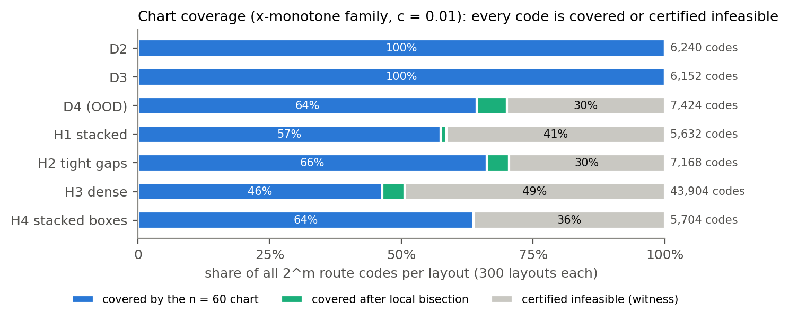

# TopoFlow

**Topology-Aware Flow Matching (TDFM)** — route-conditioned generative path planning with feasible trajectory charts.

TopoFlow studies a specific question: **can a generative model preserve variation within a selected route while enforcing obstacle clearance through its representation?** We consider static two-dimensional environments and x-monotone polygonal paths. A binary route code specifies passage above or below each obstacle, and a route-specific chart constrains the vertical waypoints of every decoded path.

## Method

The feasible chart constructs conservative clearance bands over **entire path segments**, intersects adjacent bands to obtain waypoint intervals, and maps unconstrained latent coordinates into those intervals:

$$y_i=m_i+(1-\varepsilon)\frac{r_i-\ell_i}{2}\tanh(u_i)$$

A conditional Flow Matching model learns to generate in these chart coordinates. For a successfully constructed chart and finite latent outputs, the decoder maintains the specified geometric clearance. Interpreting a binary code as a homotopy class additionally requires valid obstacle cuts; the chart does not cover every possible path.

## Results

| Evaluation | Main observation |
|---|---|
| Independent chart verification | 695,488 decoded paths and 42,631,824 segments checked; zero measured clearance violations |
| Route-code coverage audit | 82,224 route-code instances across 2,100 layouts, separating chart success, refinement, and restricted-family infeasibility |
| Paired generation/correction study | 460,800 paths checked; both chart-space generation and chart-corrected sampling had zero measured violations |
| Class-matched fidelity | TDFM retained approximately 95% of reference within-class diversity on D2 and D3, but generated paths closer to obstacle boundaries |

Direct chart-space generation preserved more within-class diversity at lower measured CPU inference cost than the tested **DiRecT-inspired rectified-flow chart-correction baseline**. This is an adaptation, not a reproduction of the original DiRecT algorithm.



*Default-grid and refined chart coverage across the tested environment families. This is a chart-construction audit, not a measure of trained-model generalization to every displayed environment.*

## Installation

Python 3.10 or newer is required. Install from the repository root:

```bash
python -m pip install -e ".[test]"
```

### Minimal example: decode a feasible path

```python
import numpy as np
from topoflow.env import e0_env
from topoflow.chart import bounds, decode, to_path

env = e0_env()
clearance = 0.01
lo, hi, feasible = bounds(env, (0,), clearance, n=60)
assert feasible

latent = np.zeros(60)
path = to_path(env, decode(latent, lo, hi), clearance)
assert not env.path_collides(path, margin=clearance)
print(path.shape)  # (62, 2)
```

This example tests the deterministic chart decoder; training and sampling the conditional neural model require the corresponding datasets and weights.

## Verification

```bash
python -m pytest -q
python -m tools.verify_evidence
python -m tools.replay_coverage_figure
```

These checks validate the included source, saved results, and reproducible coverage figure. Some historical training and full neural evaluations require archived dataset and checkpoint files not distributed here; see [reproduction instructions](docs/reproduction.md).

## Repository guide

| Directory | Contents |
|---|---|
| [`topoflow/`](topoflow/) | Environments, topology, baselines, feasible charts, and learned models |
| [`experiments/`](experiments/) | Baseline, topology, geometric-analysis, chart, and final-validation experiments |
| [`tests/`](tests/) | Geometry, topology, statistics, and evaluation checks |
| [`results/`](results/) | Selected experimental results, including final evaluation summaries |
| [`figures/`](figures/) | Research figures |
| [`docs/`](docs/) | [Methodology](docs/methodology.md), [experiments](docs/experiments.md), [theory](docs/theory.md), [evidence](docs/evidence_index.md), [reproduction](docs/reproduction.md), and [limitations](docs/limitations.md) |
| [`paper/`](paper/) | Manuscript area |

The research scope is limited to static 2D environments and the specified x-monotone path family. Historical experiment scripts may expect **trusted local artifacts** and can perform work when imported; consult the [execution matrix](docs/execution_matrix.md) before running them.

## License

MIT License — see [LICENSE](LICENSE).
